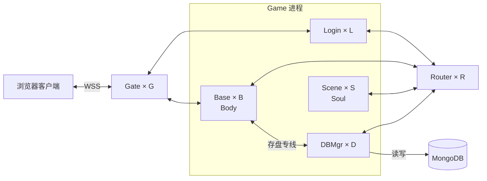

# 服务器架构与进程拓扑

设计确认日期：2026-11-06。

TGame 通过 Gate 接入玩家，通过 Router 在 Game 进程之间转发普通业务消息。Base 使用专用长连接向 DBMgr 发送存盘请求。这个划分让 Base 和 Scene 可以按各自的负载增减实例。

## 进程职责

Entity 承载游戏数据和逻辑，每个 Entity 有唯一的 `EntityId`。Game 是业务进程的大类，包含 Login、Base、Scene 和 DBMgr。

| 进程 | 职责 |
| --- | --- |
| Gate（Gateway） | 保持客户端连接，向 Login 或 Base 转发玩家请求，并向客户端回送消息。 |
| Login | 处理玩家登录。 |
| Base | 承载玩家的 Body，管理与场景、战斗无关的属性和逻辑，例如用户名、称号、公会 ID。 |
| Scene | 在场景中承载玩家的 Soul，管理场景和战斗相关的属性和逻辑，例如场景 ID、生命值、攻击力。 |
| Router | 维护 `EntityId → ProcessId` 的运行位置映射，将普通 S2S 消息转发到承载目标 Entity 的 Game 进程。 |
| DBMgr（DB Manager） | 接收 Base 定向发送的 Entity 存盘请求，读写 MongoDB。 |

## 连接拓扑

每个浏览器客户端连接一个 Gate，线上使用 WSS。进程间 RPC 使用 gRPC for .NET。图中服务进程之间的每条双向线代表两类实例两两保持长连接。

各进程启动时向 ZooKeeper 注册自己的 `ProcessId` 和通信地址 `IP:Port`。每个进程在本地缓存这张进程地址表，随注册信息变化更新。ZooKeeper 提供进程地址，Router 记录 Entity 运行在哪个进程。

## 消息路径

| 操作 | 请求路径 |
| --- | --- |
| 玩家登录 | 客户端 → Gate → Login |
| 玩家操作 Body | 客户端 → Gate → Base |
| Body 调用场景中的 Soul | Base → 一个 Router → 承载目标 Soul 的 Scene |
| Body 存盘 | Base → 负责该 Entity 的 DBMgr → MongoDB |

普通 S2S 请求选择一个 Router 转发。存盘时，Base 按 `EntityId` 选择 DBMgr，通过两者之间的长连接直接发送。在同一次存盘归属期间，各 Base 对同一 `EntityId` 应选中同一个 DBMgr。具体分配算法、归属切换时如何交接未完成的写入，以及如何防止迟到的旧数据覆盖新数据，留到存盘设计时确定。

## 连接数与扩缩容

按图中字母表示各类进程的实例数，每对相连的服务进程计一条业务长连接。

| 连接关系 | 连接数 |
| --- | ---: |
| 每个 Gate 与所有 Login、Base | `G × (L + B)` |
| 每个 Router 与所有 Game | `R × (L + B + S + D)` |
| 每个 Base 与所有 DBMgr | `B × D` |

内部业务长连接总数为 **`G × (L + B) + R × (L + B + S + D) + B × D`**。客户端会话、ZooKeeper 会话和 MongoDB 连接单独统计。其他实例数固定时，增加一个 Base 需要新增 `G + R + D` 条长连接，增加一个 Scene 只需新增 `R` 条。
