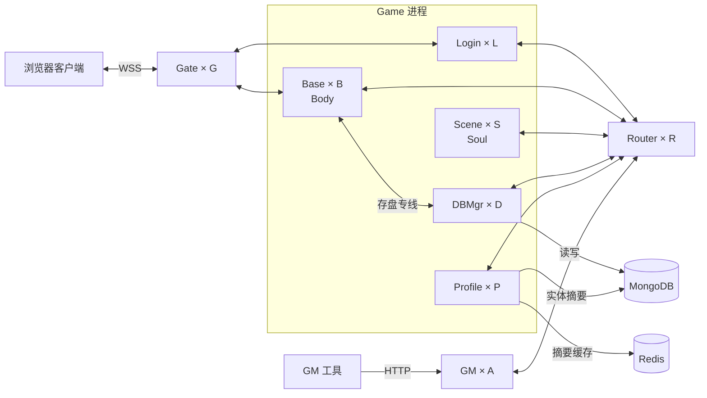

# 服务器架构与进程拓扑

设计确认日期：2026-11-06。

TGame 通过 Gate 接入玩家，通过 GM 接收管理工具的 HTTP 指令，通过 Router 在进程之间转发消息。Base 使用专用长连接向 DBMgr 发送存盘请求。这个划分让 Base 和 Scene 可以按各自的负载增减实例。

## 进程职责

Entity 承载游戏数据和逻辑，每个 Entity 有唯一的 `EntityId`。Game 是业务进程的大类，包含 Login、Base、Scene、DBMgr 和 Profile。

服务进程是带进程类型的 Entity 容器。Gate、GM、Login、Base、Scene、Router、DBMgr 和 Profile 每个进程实例各持有一个自己的 SinglePoint Entity。进程类型与类的绑定以类声明上的 `[SinglePointFor(ProcessType.Base)]` 等标注为准。宿主在监听端口及注册 ZooKeeper 前扫描已加载的实体逻辑程序集，检查每种进程类型恰有一个可实例化的 SinglePoint 类，再按本进程类型创建实例。

宿主完成地址发现后调用实例的 `Initialize`。公共初始化登记自身 EntityId 并发起拓扑规定的出站连接，各类型可以重写该方法以扩展启动流程。通用宿主管理传输和就绪状态。一个 Base 可以同时承载该进程级 Entity 和多个玩家的 Body。

| 进程 | 职责 |
| --- | --- |
| Gate（Gateway） | 保持客户端连接，向 Login 或 Base 转发玩家请求，并向客户端回送消息。 |
| GM | 接收本机管理工具的 HTTP 指令，校验操作员凭据，通过 Router 定向调用 Entity，记录请求 ID、执行人、目标和结果。首个指令为只读 `ping`。 |
| Login | 处理玩家登录。 |
| Base | 承载玩家的 Body，管理与场景、战斗无关的属性和逻辑，例如用户名、称号、公会 ID。 |
| Scene | 在场景中承载玩家的 Soul，管理场景和战斗相关的属性和逻辑，例如场景 ID、生命值、攻击力。 |
| Router | 维护 `EntityId → ProcessId` 的运行位置映射，将普通 S2S 消息转发到承载目标 Entity 的 Game 进程。 |
| DBMgr（DB Manager） | 接收 Base 定向发送的 Entity 存盘请求，读写 MongoDB。 |
| Profile | 按 EntityId 保存可供其他实体拉取的摘要。MongoDB 存储摘要，Redis 缓存近期读取结果。 |

## 连接拓扑

每个浏览器客户端连接一个 Gate，线上使用 WSS。进程间 RPC 使用 gRPC for .NET。图中服务进程之间的每条双向线代表两类实例两两保持长连接。

各进程启动时向 ZooKeeper 注册自己的 `ProcessId` 和通信地址 `IP:Port`。每个进程在本地缓存这张进程地址表，随注册信息变化更新。ZooKeeper 提供进程地址，Router 记录 Entity 运行在哪个进程。

## 消息路径

| 操作 | 请求路径 |
| --- | --- |
| 玩家登录 | 客户端 → Gate → Login |
| GM 探测目标 Entity | GM 工具 → GM → Router → 目标 Entity 所在进程，结果原路返回 |
| 玩家操作 Body | 客户端 → Gate → Base |
| Body 调用场景中的 Soul | Base → 一个 Router → 承载目标 Soul 的 Scene |
| Body 存盘 | Base → 负责该 Entity 的 DBMgr → MongoDB |
| 发布或撤回实体摘要 | 实体所在 Game → Router → Profile → MongoDB，并失效该实体的 Redis 缓存 |
| 拉取另一实体的摘要 | 调用方 Game → Router → Profile，Redis 命中时直接返回，未命中时读取 MongoDB 并回填 |

普通 S2S 请求选择一个 Router 转发。存盘时，Base 按 `EntityId` 选择 DBMgr，通过两者之间的长连接直接发送。在同一次存盘归属期间，各 Base 对同一 `EntityId` 应选中同一个 DBMgr。具体分配算法、归属切换时如何交接未完成的写入，以及如何防止迟到的旧数据覆盖新数据，留到存盘设计时确定。

Profile 使用[摘要协议](../shared/protocols/profile.proto)，首版字段为 EntityId、显示名、称号。Router 校验发布和撤回来自该 Entity 当前登记的归属进程。拉取按目标 EntityId 查询持久化摘要，实体下线后仍可拉取，主动撤回后返回 Missing。现阶段验收使用一个 Profile 实例，复用云端现有 MongoDB 和 Redis，使用专属集合与键前缀；容量依据见[环境配置落地记录](../../docs/环境配置落地记录.md#profile-存储容量评估)。

## 连接数与扩缩容

按图中字母表示各类进程的实例数，每对相连的服务进程计一条业务长连接。

| 连接关系 | 连接数 |
| --- | ---: |
| 每个 Gate 与所有 Login、Base | `G × (L + B)` |
| 每个 Router 与所有 Game | `R × (L + B + S + D + P)` |
| 每个 GM 与所有 Router | `A × R` |
| 每个 Base 与所有 DBMgr | `B × D` |

内部业务长连接总数为 **`G × (L + B) + R × (L + B + S + D + P + A) + B × D`**。客户端会话、管理工具 HTTP 请求、ZooKeeper 会话、MongoDB 与 Redis 连接单独统计。每种进程运行一个实例时共有 9 条内部业务长连接。其他实例数固定时，增加一个 Base 需要新增 `G + R + D` 条长连接，增加一个 Scene、Profile 或 GM 需要新增 `R` 条。
