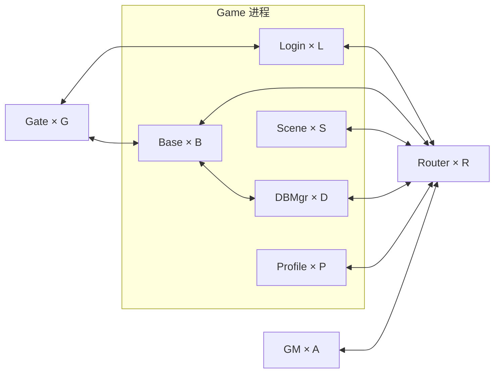

# 服务器架构与进程拓扑

设计确认日期：2026-11-06；启动连接门槛更新：2026-11-19。

当前服务器保留进程角色与连接拓扑，提供 ZooKeeper 占号和发现、双向长连接、基础 RPC、日志与雪花 ID。实体生命周期、实体注册与路由、玩家入口和业务 RPC 尚未接入当前框架；各角色运行同一个服务器程序。

## 进程职责

进程实例统一使用类型名加从 1 开始的编号，例如 `Router1`、`Base1`。类型名称保留 Gate、GM、Login、Base、Scene、Router、DBMgr、Profile；名称表示角色与连接关系，不表示已经启用对应业务服务。

宿主依次初始化日志、加载配置、建立 ZooKeeper 会话，以空地址临时节点抢占实例编号，然后初始化 ID 生成器、启动监听并连接主动依赖。`ServerGroup` 从 `process.yaml` 的 `processes` 读取每种类型的首次连接门槛并注入节点；每种主动目标类型的已握手不同实例数同时达到门槛时，`FirstLinks` 完成且 `ServerNode.Ready` 为真，宿主随后发布监听地址并记录 `PROCESS_READY`。例如 `Router: 2` 要求依赖 Router 的进程首次至少连接两个 Router。

进程握手只交换进程身份。主动方可以尚未发布地址，但必须已占用合法临时身份；接收方必须已就绪。类型依赖配置必须无环，默认 Router 无主动依赖，可直接就绪后发布地址，不等待入站连接。门槛为 `0` 的主动目标类型不阻塞启动或健康状态，但仍参与发现与连接；入站连接不替代主动依赖，达到门槛后的额外实例不阻塞启动。

`FirstLinks` 只完成一次。完成后，每种正门槛类型至少保留一条可用连接即保持 `Ready`；失去某类最后一条连接时报告连接不全并降为未就绪，恢复一条握手连接即可恢复。断线不撤销 `FirstLinks`，也不重新执行较高的首次数量门槛。ZooKeeper 会话失效后终止进程，不能继续使用旧实例身份或 worker 租约。

| 进程类型 | 当前默认主动连接目标 |
| --- | --- |
| Gate（Gateway） | Login、Base |
| GM | Router |
| Login | Router |
| Base | Router、DBMgr |
| Scene | Router |
| Router | 无 |
| DBMgr（DB Manager） | Router |
| Profile | Router |

## 连接拓扑

进程间 RPC 使用 gRPC for .NET。图中每条双向线代表两类在线实例两两保持长连接；连接由 `process.yaml` 的 `connections` 指定的一端主动发起，建立后双方均可发送请求。图中只展示当前已保留的进程连接。

`process.yaml` 的 `connections` 声明主动连接类型，ZooKeeper 临时节点提供实际在线实例及可用地址。每个进程持续读取带 Watch 的成员快照，维护所有匹配实例的连接；空地址占号不参与发现，新增、离开、地址变化及同名重建都会收敛。`process.yaml` 的 `processes` 同时供控制台决定初始启动次数，并为运行时提供首次连接门槛；数量不限制最大连接数或合法实例编号，也不展开固定实例名单。首次达标后 Watch 与连接维护继续运行，新出现的匹配实例仍会连接。

## 基础 RPC 与保留的业务组件

调用方使用 `ServerNode.CallPeerAsync` 指定已连接的进程实例。`Frame` 分为 `Hello`、`Request` 和 `Reply`；请求与响应通过 `RequestId` 关联，`Any` 承载 `Payload`，响应在 `Payload` 与 `Error` 之间二选一。超时、主动取消、断线及无效信封仍按错误结束调用。

当前没有业务请求处理入口，对合法基础 RPC 请求返回 `Unimplemented`。Router 与其他角色采用相同的基础通信行为，不维护实体归属，也不转发请求到第三个进程。已移除的实体及转发字段在 Protobuf 中保留字段号和名称，避免被后续协议误用。

`server/logic/storage/` 中的 MongoDB、Redis 和 Profile 存储工具，以及 `shared/protocols/profile.proto` 继续保留，供独立使用和后续业务设计。服务器启动不初始化这些存储工具，不要求 DBMgr/Profile 的数据库凭据，不开放对应的实体或 Profile RPC。历史业务方案与验收记录不代表当前框架已提供这些能力。

## 连接数与扩缩容

按图中字母表示各类进程的实例数，每对相连的服务进程计一条长连接。

| 连接关系 | 连接数 |
| --- | ---: |
| 每个 Gate 与所有 Login、Base | `G × (L + B)` |
| 每个 Router 与所有 Game | `R × (L + B + S + D + P)` |
| 每个 GM 与所有 Router | `A × R` |
| 每个 Base 与所有 DBMgr | `B × D` |

内部长连接总数为 **`G × (L + B) + R × (L + B + S + D + P + A) + B × D`**。ZooKeeper 会话单独统计；独立存储工具使用的数据库连接不属于此拓扑。每种进程运行一个实例时共有 9 条内部长连接。其他实例数固定时，增加一个 Base 需要新增 `G + R + D` 条长连接，增加一个 Scene、Profile 或 GM 需要新增 `R` 条。
