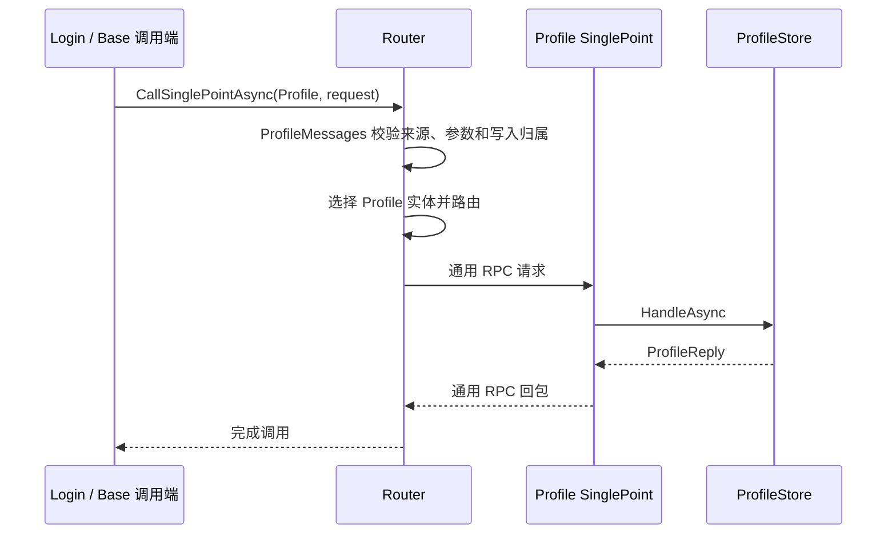

# 代码 Review 路径

更新时间：2026-11-17（Asia/Shanghai）。阅读基线：当前 `review-1117` 分支，包含 Engine 与业务 Shared 分离、实体注册迁入 SinglePoint 自身初始化流程，以及统一使用 `IdGenerator.GenId()` 静态入口后的代码。

下面均为待阅读或待复读；只有用户明确确认读完后才勾选。上一轮确认记录保留在[代码 Review 进度](代码Review进度.md)，其中旧分支和旧启动顺序不作为当前阅读基线。

接着本轮讨论，优先复读第 2～4 节：`IdGenerator.InitializeAsync` / `GenId` → `SinglePointState` → `ServerSinglePoint.InitializeAsync` → `ServerNode.InitializeSinglePointAsync` → `ServerNode.Entities.cs` → `RunLinkAsync` 的重连与清理。重点确认“初始化进程生成器、预分配 ID、建立进程连接、登记实体、接受业务请求”各自发生的时机。首次从头阅读时仍从第 1 节开始。

[完整测试记录](2026-11-17完整测试记录.md)记录的是依赖拆分前的完整验证；拆分的检查范围见[迁移计划与执行记录](superpowers/plans/2026-11-17-engine-business-shared.md)。最新实体注册调整的短时检查见第 9 节，不代表已重新执行完整测试。

## 1. 工程边界和进程配置

- [ ] [TGame.slnx](../TGame.slnx)、[宿主工程](../code/server/app/TGame.Server.csproj)、[引擎工程](../code/server/engine/TGame.Server.Engine.csproj)、[业务共享工程](../code/shared/TGame.Shared.csproj)：确认宿主分别引用 Engine 和 Shared；Engine 只引用第三方包，Engine 与业务 Shared 之间没有项目引用。两套协议各自在所属项目生成。
- [ ] [ProcessType.cs](../code/server/engine/configuration/ProcessType.cs)、[ServerGroup.cs](../code/server/engine/configuration/ServerGroup.cs)、[processes.json](../code/server/config/processes.json)：现有角色体系归引擎，区分进程类型、实例名称与实例数量；实例由 `ServerProcess.FormatName` 统一生成 `Router1`、`Base1` 等带编号名称。
- [ ] [EngineEnvironment.cs](../code/server/engine/configuration/EngineEnvironment.cs)、[ServerRunFiles.cs](../code/server/engine/configuration/ServerRunFiles.cs)、[ServerEnvironment.cs](../code/shared/csharp/ServerEnvironment.cs)：区分引擎日志目录、运行标记与宿主业务配置、存储凭据变量。
- [ ] [ServerSettings.cs](../code/server/app/ServerSettings.cs)、[server.local.yaml](../code/server/config/server.local.yaml)：理解环境选择、配置快照、凭据变量名与配置校验。

读完应能回答：所有角色为何运行同一个程序？业务代码编译到哪个程序集？`ServerMessages` 为什么能作为业务类型扫描入口？移除业务 Shared 后 Engine 为什么仍能独立编译？

## 2. 身份与 SinglePoint

- [ ] [IdGenerator.cs](../code/server/engine/identifiers/IdGenerator.cs)、[IdGeneratorOptions.cs](../code/server/engine/identifiers/IdGeneratorOptions.cs)、[id-generator.json](../code/server/config/id-generator.json)：先看进程级唯一实例、`InitializeAsync`、静态 `GenId`、`LeaseLost` 和释放；未初始化及重复初始化如何报错，宿主如何用 `await using` 管理生命周期。调用方不再传入生成器，`IIdGenerator` 已移除。
- [ ] [SnowflakeSequence.cs](../code/server/engine/identifiers/SnowflakeSequence.cs)、[SnowflakeIdGenerator.cs](../code/server/engine/identifiers/SnowflakeIdGenerator.cs)、[IdText.cs](../code/server/engine/identifiers/IdText.cs)：再看引擎内部实现的序列生成、时钟回退、ZooKeeper 编号占用、会话失效及 ID 文本校验。
- [ ] [SinglePointState.cs](../code/server/engine/SinglePointState.cs)：创建时由属性初始化表达式直接调用 `IdGenerator.GenId()`，无需构造参数，`localEntities` 仍为空；再看 `RegisterSinglePoint`、`UnregisterSinglePoint`、`LocalEntityIds` 和 `ContainsEntity`，区分已有身份与已登记实体。
- [ ] [ServerSinglePoint.cs](../code/server/engine/ServerSinglePoint.cs)：沿 `InitializeAsync` 看 `InitializeRoleAsync` → `State.RegisterSinglePoint` → `registerEntities` 回调 → `Initialized` 变为 `true`；业务初始化失败不发起注册，注册失败或取消会撤销本地登记并保持未初始化。
- [ ] [SinglePointForAttribute.cs](../code/server/engine/SinglePointForAttribute.cs)、[SinglePointRegistry.cs](../code/server/engine/SinglePointRegistry.cs)：理解标注注册、默认实现、重复映射和初始化失败。

读完应能回答：进程名称、连接 ID、RPC 请求 ID、实体 ID 分别表示什么？为什么生成 ID 不等于注册实体？实体注册由谁发起？没有业务 SinglePoint 子类的进程为什么也能启动？

## 3. 沿启动流程读一遍

- [ ] [Program.cs](../code/server/app/Program.cs)：从参数解析进入 `RunServerAsync`，跟踪节点组装、监听、ZooKeeper 注册、连接维护、`InitializeEngineAsync`、`InitializeSinglePointAsync` 和退出监督。
- [ ] [ServerNode.cs](../code/server/engine/ServerNode.cs)：构造函数只准备身份和拓扑；`InitializeSinglePointAsync` 在 `FirstLinks` 成功后创建 SinglePoint，并注入 `RegisterEntitiesAsync` 回调。再看 `Ready` 与 `Dispose`。

当前顺序为：初始化进程 ID 生成器 → 预分配身份 → 监听与 ZooKeeper 服务注册 → 建立首次拓扑连接（只交换进程名）→ 创建 SinglePoint 并执行业务初始化 → SinglePoint 登记本地实体并发起远端注册 → 收到注册确认 → 标记 SinglePoint 初始化完成。

`FirstLinks` 只表示首次进程连接齐备，不表示实体已注册。`Ready` 还要求 SinglePoint 初始化成功、当前连接齐备以及 `RegistrationsComplete`。断线不会重置首次连接信号或重新执行业务初始化，但会撤销当前就绪，重连并收到注册确认后才恢复。

宿主直接创建 `ServerNode`。当前不存在 `GameServerNode`；具体业务实现放在 `logic/entities/SinglePoint/`。

## 4. 服务发现、拓扑与连接

- [ ] [Topology.cs](../code/server/engine/Topology.cs)：从类型间连接关系展开每个实例的连接目标和预期邻居。
- [ ] [ServiceRegistry.cs](../code/server/engine/ServiceRegistry.cs)：跟踪 `RegisterAsync`、`ResolveAsync`、重复注册失败及会话释放。这一层向 ZooKeeper 登记进程地址，与向 Router 登记实体归属是两件事。
- [ ] [TransportProtocol.cs](../code/server/engine/TransportProtocol.cs)、[LinkService.cs](../code/server/engine/LinkService.cs)：检查 `peer`、`link` 元数据、来源检查和连接交接；原来的 `EntityHeader` 已移除。
- [ ] 回到 [ServerNode.cs](../code/server/engine/ServerNode.cs)：按 `MaintainLinkAsync` → `ConnectAsync` → `RunLinkAsync` 阅读进程握手；此时只建立连接，不生成实体路由。
- [ ] [ServerNode.Entities.cs](../code/server/engine/ServerNode.Entities.cs)：先沿发送端 `RegisterEntitiesAsync` → `EnsureRegistrationAsync` → `RegisterLinkAsync`，确认注册由 SinglePoint 的回调发起，并等待 `RegisterEntitiesReply`。
- [ ] 再看同文件的 `HandleRegistrationAsync` → `RegisterPeerEntities`：检查注册只能来自当前直连进程、SinglePoint ID 必须在实体名单中、ID 格式与冲突校验，以及 Router 的 `owners` 和 SinglePoint 索引更新。注册处理不依赖接收方业务初始化完成，避免互相等待。
- [ ] 最后回到 `RunLinkAsync` 的 `RestoreRegistrationAsync`、`finally` 和 `UpdateLinkReadiness`：核对断线时移除实体归属、SinglePoint 索引及当前连接的确认记录；重连后在新连接上重新登记，复用原身份和已初始化的 SinglePoint。

Router 保存实体到进程的归属及按类型选择 SinglePoint 的索引；其他直接相邻进程同步 SinglePoint 身份，以支持现有连接上的实体调用。Gate 的 SinglePoint 不向对端注册为 RPC 目标；Router 自身的 SinglePoint 索引也在自身注册流程中建立。

读完应能回答：进程地址来自哪里？实体归属在哪里维护？为何只完成握手还不能按类型调用 Profile？为什么少一个配置实例或尚未收到注册确认时不能就绪？Base 与 DBMgr 的现有长连接和 Router 转发各自承担什么？

## 5. 通用 RPC：先看信封，再看等待与回包

- [ ] [transport.proto](../code/server/engine/protocols/transport.proto)：区分进程握手、请求、响应，以及独立的实体注册请求与确认；理解 `Any`、目标、来源、截止时间和错误结果。通用协议编译到 Engine，不导入业务协议。
- [ ] 对照 `Frame` 与 `RegisterEntitiesRequest` / `RegisterEntitiesReply`：Hello 中的 `single_point_id` 已移除并保留原字段编号；SinglePoint ID 和实体名单现在放在独立注册请求中，通过已有 RPC 信封发送和关联回包。
- [ ] [EntityRpcContext.cs](../code/server/engine/EntityRpcContext.cs)：区分原始调用进程 `SourceProcess` 与本跳来源 `PeerProcess`。
- [ ] [PeerLink.cs](../code/server/engine/PeerLink.cs)：按 `CallAsync`、`WriteAsync`、`Receive`、`ReadReply`、`Close` 跟踪请求关联、超时、取消和断线。
- [ ] [RpcDispatcher.cs](../code/server/engine/RpcDispatcher.cs)：比较普通消息注册与 `RegisterEntity`；理解可选的转发前校验回调、业务拒绝响应和未注册消息错误。
- [ ] 回到 [ServerNode.cs](../code/server/engine/ServerNode.cs)：看读循环如何直接处理响应、请求如何排队，以及实体请求如何支持嵌套调用。

读完应能画出：发起调用 → 保存等待项 → 写出请求 → 接收响应 → 找到等待项 → 完成原来的 `Task`。

## 6. 实体与 SinglePoint 路由

- [ ] [ServerNode.Routing.cs](../code/server/engine/ServerNode.Routing.cs)：依次阅读 `CallEntityAsync`、`CallSinglePointAsync`、`CreateRequest`、`RouteReplyAsync`、`RouteRequestAsync`。
- [ ] 再看同文件的 `ValidateSource`、`SelectSinglePoint`、`SelectNextLink`、`RegisterPeerSinglePoint`、`RemovePeerSinglePoint`，最后看错误转换；索引登记由独立注册请求触发，移除由断线清理触发。

重点区分：

- `CallEntityAsync` 的目标 ID 表示执行方法的实体。
- `CallSinglePointAsync(ProcessType.Profile, …)` 由 Router 从已登记的 Profile SinglePoint 中随机选择一次，再按实体 ID 投递。
- Gate 发出的实体调用可经现有 Login/Base 连接接入；对端没有目标实体时经 Router 转发。Gate 上的实体不作为 RPC 目标，Login/Base 向 Gate 发消息仍走已有连接。
- 当前没有增加 Router 之间的网状连接，也没有新增 Gate 经 Base 调用 DBMgr 的业务流程。

读完应能回答：类型何时变成具体实体 ID？原始来源如何保持？目标不存在、未就绪和回包失败分别如何结束调用？

## 7. 以一次 Profile 查询串起业务链路

- [ ] [profile.proto](../code/shared/protocols/profile.proto)：发布、查询、撤回及结果枚举。
- [ ] [ServerMessages.cs](../code/server/logic/messages/ServerMessages.cs)、[ProfileMessages.cs](../code/server/logic/messages/ProfileMessages.cs)：先看注册，再看 `CallProfileAsync`、`ValidateRoute`、`HandleAsync`、参数与响应校验。
- [ ] [ProfileServerSinglePoint.cs](../code/server/logic/entities/SinglePoint/ProfileServerSinglePoint.cs)：存储初始化、请求执行、异常转换与释放。
- [ ] [ProfileStore.cs](../code/server/logic/storage/ProfileStore.cs)、[StorageConnections.cs](../code/server/logic/storage/StorageConnections.cs)：MongoDB 持久化、Redis 命中和回填、缓存占用标记、更新后的缓存失效。

RPC 目标是执行方法的 **Profile SinglePoint**，业务请求中的实体 ID 是要读写的 **摘要所属实体**。通用 RPC 的请求 ID 负责运输关联，Profile 的业务请求 ID 原样保留在业务响应中。

写入归属检查仍在 Router 上执行，但规则定义在 `ProfileMessages`。引擎只调用通用校验回调。Profile 服务端要求请求来自 Router；调用端保留 `Rejected` / `Unavailable` 等业务结果及响应 ID 校验。

## 8. DBMgr、日志和控制台

- [ ] [DBMgrServerSinglePoint.cs](../code/server/logic/entities/SinglePoint/DBMgrServerSinglePoint.cs)、[MongoStorageSettings.cs](../code/server/logic/storage/MongoStorageSettings.cs)、[MongoStorage.cs](../code/server/logic/storage/MongoStorage.cs)、[dbmgr-storage.yaml](../code/server/config/dbmgr-storage.yaml)：独立存储配置、凭据、连接检查与失败就绪状态。
- [ ] [ServerLogProtocol.cs](../code/server/engine/logging/ServerLogProtocol.cs)、[LogEventJson.cs](../code/server/engine/logging/LogEventJson.cs)、[TraceLog.cs](../code/server/engine/TraceLog.cs)、[ProfileLogEvents.cs](../code/shared/csharp/ProfileLogEvents.cs)：通用日志设施属于 Engine，Profile 业务事件属于 Shared；日志字段和值保持原格式。
- [ ] [控制台工程](../tools/server-console/TGame.ServerConsole.csproj)、[ConsoleSession.cs](../tools/server-console/ConsoleSession.cs)、[ServerInstance.cs](../tools/server-console/ServerInstance.cs)：控制台分别引用 Engine 与业务 Shared；先看两套协议导出，再看起服、选关、补起、接管、配置快照、编译并重启及状态计算。
- [ ] [Import-ServerTypes.ps1](../tools/scripts/powershell/Import-ServerTypes.ps1)、[Read-ServerGroup.ps1](../tools/scripts/powershell/Read-ServerGroup.ps1)：脚本从引擎的唯一声明加载进程与基础类型，同时按需加载业务环境变量，不复制常量。
- [ ] [MainWindow.xaml.cs](../tools/server-console/MainWindow.xaml.cs)、[MainWindow.Logs.cs](../tools/server-console/MainWindow.Logs.cs)、[ProcessPage.cs](../tools/server-console/ProcessPage.cs)：最后看操作入口与日志展示。

当前 GM 使用默认 SinglePoint，保留拓扑连接；GM Ping 命令和 Probe Ping/Pong 已移除，不再沿旧诊断入口阅读。

## 9. 用测试反查理解

实体注册调整（`b05e619`）已完成以下小范围验证：检查工程 `code/tests/singlepoint/TGame.SinglePointTests.csproj` 编译通过，0 警告、0 错误；`--routing`、`--node`、`--profile` 模式通过。这些模式使用内存连接检查注册、生命周期和 RPC 行为，未重新执行真实 ZooKeeper、MongoDB/Redis、控制台起停或完整联调。阅读测试不需要运行测试；完整或耗时验证仍须按项目规范单独确认。

统一 `IdGenerator.GenId()` 入口后，上述检查工程重新编译通过，0 警告、0 错误，`--routing`、`--node`、`--profile` 均通过，并覆盖新增的单例生命周期检查；真实外部服务和完整测试未重跑。

| 想确认的行为 | 对应检查 |
| --- | --- |
| Engine 不引用业务 Shared、通用协议和基础类型归属正确 | [RpcChecks.CheckTransportBoundary](../code/tests/singlepoint/RpcChecks.cs)，随 `--engine` 小范围检查运行 |
| 默认实现、注册错误与两阶段初始化 | [SinglePointChecks.cs](../code/tests/singlepoint/SinglePointChecks.cs)、[Program.cs](../code/tests/singlepoint/Program.cs) |
| ID 并发、回退、会话丢失与真实编号分配 | [IdGeneratorChecks.cs](../code/tests/singlepoint/IdGeneratorChecks.cs) |
| 静态 ID 入口的初始化、取消、并发发号、租约监督和释放 | [IdGeneratorLifecycleChecks.cs](../code/tests/singlepoint/IdGeneratorLifecycleChecks.cs)，随上述内存检查模式运行 |
| 握手不登记实体、业务初始化后发起注册、等待确认、注册拒绝与重连确认 | [EntityRegistrationChecks.cs](../code/tests/singlepoint/EntityRegistrationChecks.cs)，随 `--routing` 小范围检查运行 |
| 服务注册冲突与重新注册 | [ServiceRegistryChecks.cs](../code/tests/singlepoint/ServiceRegistryChecks.cs) |
| 消息关联、嵌套调用、排队与取消 | [RpcChecks.cs](../code/tests/singlepoint/RpcChecks.cs)、[MessageDispatchChecks.cs](../code/tests/singlepoint/MessageDispatchChecks.cs) |
| Gate 接入、实例选择、身份冲突、断线路由清理和重连恢复 | [EntityRoutingChecks.cs](../code/tests/singlepoint/EntityRoutingChecks.cs)、[GroupChecks.cs](../code/tests/singlepoint/GroupChecks.cs)，随 `--routing` 小范围检查运行 |
| Profile 写入归属、参数校验与回包 | [ProfileRpcChecks.cs](../code/tests/singlepoint/ProfileRpcChecks.cs) |
| 真实 MongoDB/Redis 与 Profile 服务处理 | [ProfileStorageChecks.cs](../code/tests/singlepoint/ProfileStorageChecks.cs) |
| 配置、日志、起停、恢复与编译重启 | [控制台检查](../tools/server-console/tests/Program.cs)、[Test-ServerConsole.ps1](../tools/scripts/powershell/Test-ServerConsole.ps1) |
| 从无生成文件的目录导出引擎和业务两套协议 | [控制台检查](../tools/server-console/tests/Program.cs) 的 `--export-only` 模式；仅在带 `.console-check` 标记的隔离副本使用，不启动服务器 |

每次完成一个小节后记录问题与用户确认结果；本轮先核对第 2～4 节的新注册时机，再接着第 5～7 节串起请求与回包。
