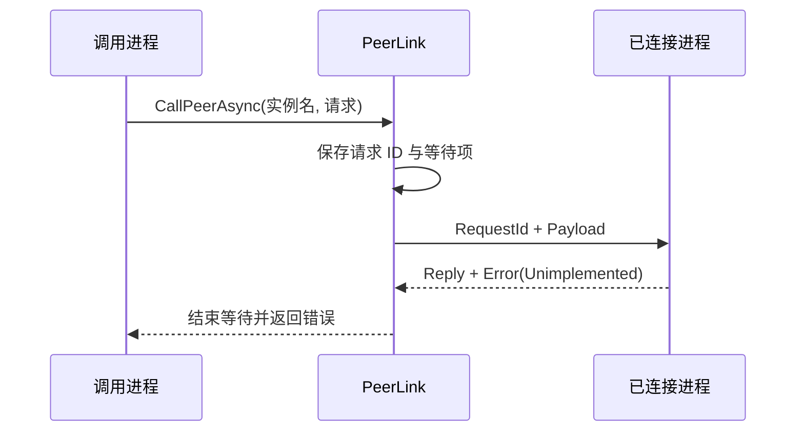

# 代码 Review 路径

更新时间：2026-11-19（Asia/Shanghai）。当前分支为 `review-1118`，服务器已收敛为进程基础框架：ZooKeeper、进程连接、基础 RPC、日志和 ID。进程服务由 App 的单个 IoC 根容器组装，使用方通过构造函数接收依赖；`process.yaml` 的 `processes` 同时提供控制台初始启动数量和运行时首次连接门槛。独立存储工具与业务共享协议保留，启动不再创建实体或初始化业务服务。

用户此前确认第一节已读完（2026-11-17）、第三节的 `Program.cs` 已理解（2026-11-18）。这些记录保留，但本次启动流程和测试入口的变化仍需核对，不自动计为已读；详细记录见[代码 Review 进度](代码Review进度.md)。

**下一步核对第三节的 `Program.cs` 与 `ServerNode.cs`。** 先看容器注册、显式异步初始化和构造函数依赖，再看 `FirstLinks`、`Ready`，然后跟踪第四节的拓扑、服务发现与连接。阅读源码无需启动服务；测试入口与历史范围放在第 7 节。

## 1. 工程边界和进程配置

- [x] [TGame.slnx](../TGame.slnx)、[宿主工程](../code/server/app/TGame.Server.csproj)、[引擎工程](../code/server/engine/TGame.Server.Engine.csproj)、[业务共享工程](../code/shared/TGame.Shared.csproj)：用户已确认工程边界。宿主分别引用 Engine 和 Shared；Engine 只引用第三方包，两套协议各自在所属项目生成。
- [x] [ProcessType.cs](../code/server/engine/configuration/ProcessType.cs)、[ServerGroup.cs](../code/server/engine/configuration/ServerGroup.cs)：用户已确认角色、实例名称与数量的区别；实例统一使用 `Router1`、`Base1` 等带编号名称。
- [x] [EngineEnvironment.cs](../code/server/engine/configuration/EngineEnvironment.cs)、[ServerRunFiles.cs](../code/server/engine/configuration/ServerRunFiles.cs)、[ServerEnvironment.cs](../code/shared/csharp/ServerEnvironment.cs)：用户已确认引擎运行标记与宿主、存储环境变量的边界。
- [x] [server.yaml](../code/server/config/server.yaml)：用户曾确认环境选择、配置快照、凭据变量名与配置校验；原宿主配置类型已合并，新实现仍须按下一项复核。
- [ ] 核对本次配置合并：[ServerConfiguration.cs](../code/server/engine/configuration/ServerConfiguration.cs) 一次加载总入口与 include、展开文件内别名、严格绑定并校验核心配置、拓扑和数量。它持有配置值与类型连接图，私有 DTO 只用于绑定；App 仅注册这一配置实例及其持有的数量和选项对象，运行期间读取快照，不使用静态全局配置。
- [ ] 核对当前 [ServerConfiguration.cs](../code/server/engine/configuration/ServerConfiguration.cs)、[ServerGroup.cs](../code/server/engine/configuration/ServerGroup.cs)、[process.yaml 的 connections](../code/server/config/process.yaml) 与 [process.yaml 的 processes](../code/server/config/process.yaml)：连接规则必须无环；数量同时决定控制台初始启动次数和运行时首次连接门槛，通过 `GetStartupMinimum(ProcessType)` 查询。实际实例仍由 ZooKeeper 动态发现，数量不是连接上限或合法编号范围。

读完应能回答：所有角色为何运行同一个程序？保留的存储代码编译到哪个程序集？Engine 为什么能独立于业务 Shared 编译？DBMgr/Profile 的角色名称为何不代表启动时初始化数据库？

## 2. 进程身份与 ID

- [ ] [IdGenerator.cs](../code/server/engine/identifiers/IdGenerator.cs)：按构造函数 → `InitializeAsync` → `GenId` → `LeaseLost` → `DisposeAsync` 阅读。理解容器内共享实例、注入的 ZK 依赖、使用前初始化、同一对象重复初始化报错和释放后不能继续发号；宿主控制初始化顺序，容器负责其创建的服务释放。
- [ ] [IdGeneratorOptions.cs](../code/server/engine/identifiers/IdGeneratorOptions.cs)、[server.yaml](../code/server/config/server.yaml)、[ZooKeeperOptions.cs](../code/server/engine/ZooKeeperOptions.cs)、[ops.yaml](../code/server/config/ops.yaml)：区分 worker 根路径与 ZooKeeper 连接、会话超时；ZooKeeper 地址及进程发现根路径来自统一 `ServerConfiguration`。
- [ ] [IdText.cs](../code/server/engine/identifiers/IdText.cs)：校验无前导零的正 `long` 十进制文本，不负责生成 ID 或判断业务对象是否存在。
- [ ] [SnowflakeSequence.cs](../code/server/engine/identifiers/SnowflakeSequence.cs)、[SnowflakeIdGenerator.cs](../code/server/engine/identifiers/SnowflakeIdGenerator.cs)：主线读通后再看时间戳、worker、序号组合、同毫秒序列耗尽、时钟回退、租约有效性与释放。

区分三种标识：进程实例名表示本次占号的进程，连接 ID 表示一次连接，RPC 请求 ID 关联一次请求与响应。进程实例编号与雪花 worker 编号独立；当前节点不生成实体身份。调用与限制见[统一 ID 生成](雪花ID.md)。

## 3. 沿启动流程读一遍

- [x] [Program.cs](../code/server/app/Program.cs)：用户已理解此前的宿主组装、并发任务、`Task.WhenAll`、停止文件与会话监控、异常监督、取消和释放。
- [ ] 核对本次 IoC 组装后的 `Program.cs`：日志创建 → 配置加载 → 构建根容器 → ZooKeeper 会话及空地址临时占号 → ID 初始化 → 解析节点和启动监听 → 首次连接数量达标 → 发布服务地址 → `PROCESS_READY`。跟踪连接配置、`ServerGroup`、ZK、ID、身份和节点的注册与解析时机，并核对 App 输出中的 `config/server.yaml`；`WriteProcessIdentity` 单独负责通过临时文件发布本机身份记录。当前不扫描业务类型，也不初始化 DBMgr/Profile 存储；配置包含环境名、运行目录、进程数量/拓扑与完整 ZooKeeper 参数，存储字段由独立工具使用时校验。
- [ ] [ServerNode.cs](../code/server/engine/ServerNode.cs)：构造函数接收进程身份、连接配置、`ServerGroup`、ZK、ID 和日志；名称和角色从身份对象派生，所需连接类型直接查询配置。核对 `FirstLinks`、`Ready`：首次按主动目标类型统计已握手的不同实例，达到各自门槛；门槛为 `0` 的类型不阻塞，无主动依赖可直接就绪，不等待入站。

`FirstLinks` 只完成一次；完成后，`Ready` 只要求每种正门槛类型至少一条握手连接。例如 `Router: 2` 首次需两个 Router，之后降到一个仍就绪，全部断开会报告连接不全并撤销当前就绪，恢复一个即可恢复；不撤销 `FirstLinks`，也不重新要求两个。门槛为 `0` 的类型不影响健康状态。入站连接不替代主动依赖，达到首次门槛后的额外实例不阻塞启动。

宿主监督停止请求与 ZooKeeper 会话。会话失效意味着进程实例身份和 worker 租约均不可继续使用，必须退出；普通对端断线由引擎持续重连，不等于本进程立即退出。退出时先取消并等待后台工作、停止监听，再异步释放容器；ID 先于 ZK 释放。日志由 App 提前创建并注册为已有共享实例，最后显式释放，以便记录容器构建、初始化或清理阶段的失败。

读完应能指出：谁占号，谁初始化 ID，谁等待首次连接，何时发布地址与记录进程就绪，以及哪个任务失败会触发退出。

## 4. 服务发现、拓扑与连接

- [ ] [ServerConfiguration.cs](../code/server/engine/configuration/ServerConfiguration.cs)：通过实例方法 `GetDialTargets`、`Dials` 和 `ArePeers` 按类型连接规则匹配动态成员，区分主动目标与入站邻居；`ValidateAcyclic` 独立负责启动依赖的无环检查。
- [ ] [ZooKeeperProxy.cs](../code/server/engine/ZooKeeperProxy.cs)、[ZooKeeperSession.cs](../code/server/engine/ZooKeeperSession.cs)：跟踪空地址占号、地址发布、成员快照和 Watch、身份校验、`SessionLost` 与释放。空地址节点不参与拨号，但可证明主动方持有实例身份。`EnsurePathAsync` 负责公共根目录，`TryCreateEphemeralAsync` 复用抢占步骤，`ReadDiscoveredProcessAsync` 处理单条发现记录；进程编号与 worker 编号仍各自管理申请范围和时序。
- [ ] [DiscoveredProcess.cs](../code/server/engine/DiscoveredProcess.cs)、[ServerNode.Discovery.cs](../code/server/engine/ServerNode.Discovery.cs)：成员新增、离开、地址变化和同名重建如何取消旧连接并按快照收敛。首次达标后 Watch 与连接维护仍持续运行，后续新增实例和门槛为 `0` 的目标类型也继续连接，不因数量达标停止拨号。
- [ ] [TransportProtocol.cs](../code/server/engine/TransportProtocol.cs)、[LinkService.cs](../code/server/engine/LinkService.cs)：检查 `peer`、`link` 元数据、来源占号身份、本地就绪与连接交接。
- [ ] 回到 [ServerNode.cs](../code/server/engine/ServerNode.cs)：沿连接维护、拨号、握手和读循环看成功与失败分支；`RunLinkAsync` 管理握手与连接登记/注销，`RunTransportAsync` 管理收发与取消协调；断线时撤销连接状态、结束等待项，重新连接后更新就绪。

读完应能回答：为什么依赖关系不能成环？Router 为何可以先发布地址？Base 为何分别按 Router 与 DBMgr 的数量等待而不等 Gate？`Router: 2` 达标后为何剩一个仍就绪、全部断开后恢复一个即可？首次达标后为何仍会连接新增 Router？

## 5. 基础 RPC：信封、请求关联与错误

- [ ] [transport.proto](../code/server/engine/protocols/transport.proto)：`Frame` 分为 `Hello`、`Request` 和 `Reply`；请求用 `RequestId` 关联响应，响应中的 `Payload` 与 `Error` 二选一。`Any` 不依赖业务协议；已移除的实体、来源及转发字段保留字段号和名称。
- [ ] [PeerLink.cs](../code/server/engine/PeerLink.cs)：按信封校验、`CallAsync`、写出、接收响应、读取结果和关闭顺序跟踪请求关联、超时、取消及断线。
- [ ] [ServerNode.cs](../code/server/engine/ServerNode.cs)：看 `CallPeerAsync` 如何选择指定的已连接实例，读循环如何关联响应、处理请求，以及当前没有业务处理入口时如何返回 `Unimplemented`。

这是直接连接上的请求与响应；当前 Router 不选择业务实例、不按实体 ID 路由，也不转发到第三个进程。读完应能画出“发起调用 → 保存等待项 → 写出请求 → 接收响应 → 完成原来的 Task”，并区分业务未实现、无连接、超时、取消和断线。

## 6. 日志、控制台与独立存储工具

- [ ] [ServerLogLevel.cs](../code/server/engine/logging/ServerLogLevel.cs)、[GameLog.cs](../code/server/engine/GameLog.cs)：从 `ServerConfiguration.MinimumLogLevel` 追到日志实例创建、注入、级别过滤、文件开启与释放。理解 App 提前创建且最后释放日志的原因。缺省为 `Info`，当前本地配置为 `DEBUG`。
- [ ] [ServerLogProtocol.cs](../code/server/engine/logging/ServerLogProtocol.cs)、[LogEventJson.cs](../code/server/engine/logging/LogEventJson.cs)：看事件、实例、连接、请求及等级如何写入 JSON；`ProcessReady` 的事件值为 `PROCESS_READY`。
- [ ] [控制台工程](../tools/server-console/TGame.ServerConsole.csproj)、[ConsoleSession.cs](../tools/server-console/ConsoleSession.cs)、[ServerInstance.cs](../tools/server-console/ServerInstance.cs)：控制台分别引用 Engine 与业务 Shared，将同一启动计划保存到运行目录与可执行快照的 `config/server.yaml`，保证起服数量和首次连接门槛一致；按启动计划起服、获配实例名和 `ProcessReady` 更新状态，再看精确停止、恢复和编译重启。
- [ ] [Import-ServerTypes.ps1](../tools/scripts/powershell/Import-ServerTypes.ps1)、[Read-ServerGroup.ps1](../tools/scripts/powershell/Read-ServerGroup.ps1)：脚本从引擎唯一声明加载基础类型，按需加载业务环境变量，不复制常量。
- [ ] [ProfileStore.cs](../code/server/logic/storage/ProfileStore.cs)、[StorageConnections.cs](../code/server/logic/storage/StorageConnections.cs)、[MongoStorage.cs](../code/server/logic/storage/MongoStorage.cs)、[MongoStorageSettings.cs](../code/server/engine/configuration/MongoStorageSettings.cs)：`MongoStorageSettings` 是 Engine 中的纯配置，其余是 logic 中的独立存储实现。按需阅读，不把它们理解为当前启动阶段；存储实现未通过进程 RPC 暴露。
- [ ] [profile.proto](../code/shared/protocols/profile.proto)、[ProfileLogEvents.cs](../code/shared/csharp/ProfileLogEvents.cs)：业务协议和事件仍由 Shared 持有，不进入引擎传输层。

## 7. 用测试反查理解

阅读测试不需要执行测试。优先关注准备状态、执行步骤与断言结果；完整、耗时或外部服务联调仍须按规范单独确认。

当前检查项目为 [TGame.EngineTests.csproj](../code/tests/engine/TGame.EngineTests.csproj)，实际入口集中在 [Program.cs](../code/tests/engine/Program.cs)。按功能选择命令：

| 阅读内容 | 检查入口 |
| --- | --- |
| 进程握手、当前就绪与基础 RPC | `--engine`；`--node` 为同义入口，无参数也只运行 engine |
| 首次连接数量门槛、零门槛及达标后的连接健康 | `--connection-readiness` |
| 动态成员、后续新增实例及冗余连接 | `--dynamic-topology`、`--discovery-links` |
| IoC 共享、容器隔离与释放 | `--ioc`，不连接外部服务 |
| 配置、日志和本地会话生命周期守卫 | `--configuration`、`--logging`、`--zookeeper-session`，不连接外部服务 |
| 真实 ZooKeeper 占号、地址发布与身份校验 | `--registry`、`--startup-publication` |
| 真实 ZooKeeper worker 租约与发号 | `--id-zookeeper code/server/config/server.yaml` |
| 独立 MongoDB 配置、取消及连接失败 | `--mongo-storage`，使用本地回环测试端点，无需真实数据库 |
| 真实 MongoDB/Redis 的独立 Profile 存储 | `--profile-storage code/server/config/server.yaml`，需 ZooKeeper 与存储服务 |
| 控制台就绪状态、身份、恢复与精确停止 | [控制台检查](../tools/server-console/tests/Program.cs) 的 `--state-only`；`--identity-only` 只检查身份 |
| 完整控制台进程组联调 | [Test-ServerConsole.ps1](../tools/scripts/powershell/Test-ServerConsole.ps1)，需另行确认执行范围 |

命令示例与环境要求见[服务器启动与动态发现](服务器组配置.md)和[统一 ID 生成](雪花ID.md)。[2026-11-17 完整测试记录](2026-11-17完整测试记录.md)及 `docs/superpowers/` 中旧方案保留历史适用范围，其中实体与业务 RPC 的结果不代表当前框架已经验证。本文更新没有执行或宣称新的联调通过。

每次完成一个小节后记录问题与用户确认结果。已理解的 C# 基础不必从头复讲，重点核对 IoC 组装与实例依赖、启动顺序、连接就绪和 RPC 错误行为。
