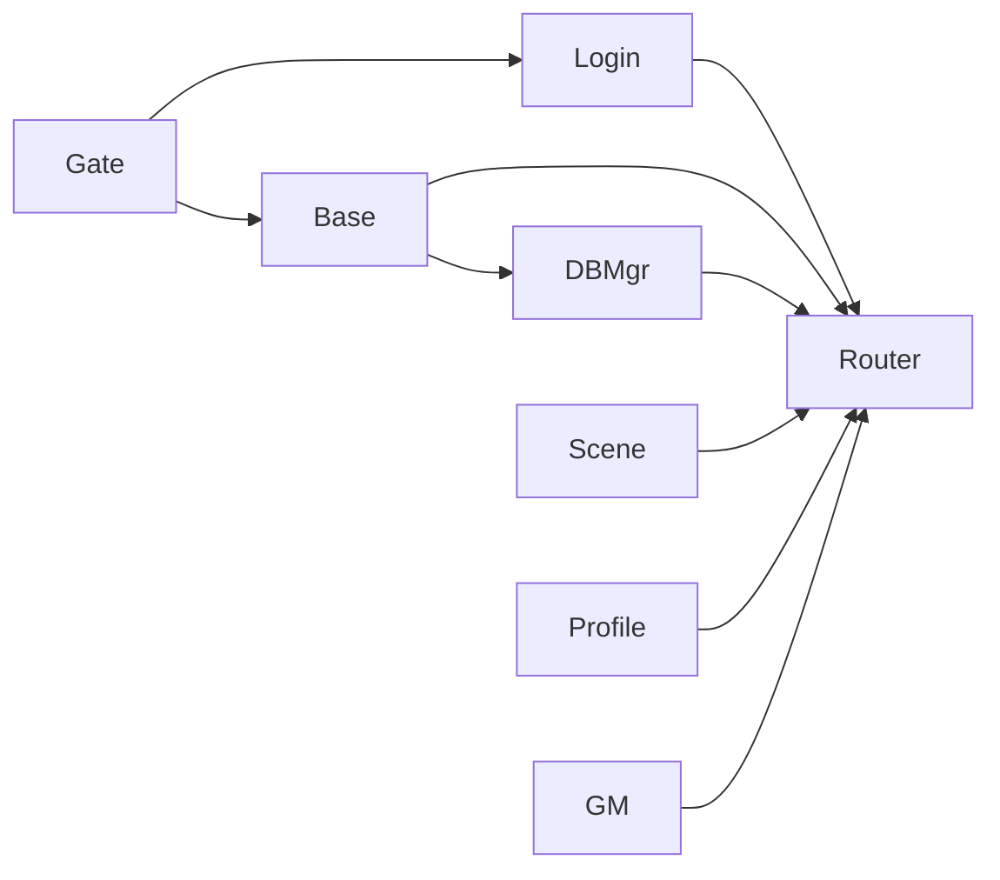

# 游戏服务器的进程拓扑和连接：让一组进程自己连起来

上一篇把技术选型过了一遍，接下来开始搭服务器。

目前项目已经能启动一组进程。不过，把几个程序拉起来，离“服务器启动完成”还有一段距离：每个进程要知道自己是谁、该连接谁，还要能判断什么时候可以开始接收其他进程的连接。运行过程中，有进程退出，也有新进程加入，这些变化同样得处理。

这一篇就沿着一个 `Base` 进程的启动过程，把这些事情串起来。当前项目还处于基础框架阶段，角色、场景、存盘等业务没有接入，先把进程之间的关系和通信跑通。

## 先确定谁连接谁

项目里目前定义了八种进程类型：`Gate`、`Login`、`Base`、`Scene`、`Router`、`DBMgr`、`Profile` 和 `GM`。这些名字先用来区分进程，暂时不要据此理解成对应业务都已经实现。

这里要先区分两个概念：**类型和实例**。`Base` 是类型，实际跑起来的进程叫 `Base1`、`Base2`。即便只有一个，也叫 `Base1`，这样以后增加进程时就不用改命名规则了。

所谓进程拓扑，可以先理解为一张连接关系图：哪些类型之间需要连线，由谁主动发起连接。

当前的关系写在 `process.yaml` 中：

```yaml
connections:
  Router: []
  DBMgr: [Router]
  Scene: [Router]
  Login: [Router]
  Base: [Router, DBMgr]
  Profile: [Router]
  GM: [Router]
  Gate: [Login, Base]
```

读法很直接。`Base: [Router, DBMgr]` 表示每个 `Base` 实例都要主动寻找并连接 `Router` 和 `DBMgr` 实例。`Router: []` 表示它没有主动连接的目标，可以等其他进程来连接自己。

把配置画出来，就是下面这张图。箭头从主动连接方指向接收方：



箭头只规定建连方向。连接使用 gRPC 双向流，建立以后，两端都可以发送请求和响应。例如 `Base1` 主动连上 `DBMgr1` 后，`DBMgr1` 也能沿着这条连接向 `Base1` 发请求，不需要再反向建一条。

图里有一条从 `Gate` 经过 `Base` 到 `DBMgr` 的路径，也不代表 `Gate` 已经能间接调用 `DBMgr`。当前框架只提供已连接实例之间的直接调用，没有沿着拓扑自动转发请求的功能。`Router` 这个名字，也不意味着它现在已经在转发业务消息。

## Base 进程启动后，先给自己占个号

启动一个进程时，传给程序的是类型，例如 `Base`。具体叫 `Base1` 还是 `Base2`，在连接 ZooKeeper 之后确定。

程序从编号 1 开始，尝试创建对应的临时节点。`Base1` 已经被占用，就继续尝试 `Base2`，直到找到一个空位。占号是否成功，以 ZooKeeper 创建节点的结果为准。

这样，启动器只需要表达“再启动一个 Base”，实例编号由进程自己申请。这个编号也不是永久身份：旧节点释放以后，后来的进程可能重新取得同一个名字。

占号时，节点里的地址先留空。

这个空地址很关键。它表示 `Base1` 已经存在，正在初始化，但其他进程还不能通过服务发现把它当成可连接的目标。等它准备好了，再把真实监听地址写进去。

如果一拿到名字就发布地址，依赖 `Base` 的 `Gate` 就可能过早找上门。把占号和地址发布拆开，启动过程就有了一个明确的中间阶段。

在当前实现里，启动顺序是：先创建日志、加载配置，再建立 ZooKeeper 会话并占号；随后初始化 ID、启动监听、连接依赖；满足首次连接条件以后，才发布地址，记录 `PROCESS_READY`。

日志和 ID 的实现细节这里先不展开，它们同样是发布地址之前要完成的准备工作。

## 不写死地址，持续发现需要的实例

`Base1` 知道自己要连接 `Router` 和 `DBMgr`，但配置里没有要求它连接某个固定端口。

地址来自 ZooKeeper 中已经发布的进程记录。服务发现会读取这些记录，过滤掉地址为空或不合法的节点，再把当前的实例列表交给连接管理。

假设此时发现了 `Router1`、`Router2`、`DBMgr1` 和 `Scene1`，`Base1` 会选择前面三个作为连接目标。`Scene1` 虽然能被发现，但不在 `Base` 的主动连接规则里，不会因此建立连接。

这也说明，配置描述的是类型之间的关系。实例数量变化后，同一条规则仍然适用：新增一个 `Router3`，已有的 `Base` 实例也会去连接它。

服务发现会持续监听变化，包括成员增删和节点地址变化。只监听成员增删是不够的，因为“占号时地址为空，准备完成后写入地址”并不会新增一个节点。

连接管理收到新列表后，会保留没有变化的连接任务，取消已经消失或发生变化的目标，再为新增目标建立连接任务。实现里还记录了 ZooKeeper 节点的创建代次，用来区分同名进程退出后重新占号的情况。

做到这里，进程数量和地址就不必固定在代码里了。

## 连上几个，才算启动完成

能发现目标，还需要定义一个明确的启动条件。

`process.yaml` 的另一部分是 `processes`，当前八种类型都配置为 1。这组数量有两个用途：控制台初始启动多少个进程，以及依赖该类型的进程首次需要连上多少个实例。

因此，按当前配置，`Base1` 要完成启动，需要至少连上一个 `Router` 和一个 `DBMgr`。

这里的“连上”是完成了进程身份握手。仅仅发现一条地址，或者底层网络已经接通，都还不能计入数量。同一个实例重复建立连接，也不能算成两个。

换一个例子，如果把 `Router` 的数量改为 2，`DBMgr` 仍为 1，那么 `Base1` 的判断会是：

| 已完成握手的连接 | 是否满足首次启动条件 |
| --- | --- |
| Router1、DBMgr1 | 否，还差一个 Router |
| Router1、Router2 | 否，还差一个 DBMgr |
| Router1、Router2、DBMgr1 | 是 |

数量要按目标类型分别满足。多连一个 `Router`，不能替代缺少的 `DBMgr`。

代码里用 `FirstLinks` 这个任务表示首次连接条件达成，`Ready` 直接读取它是否成功完成。App 等到 `FirstLinks` 完成以后，才继续发布地址。

这组数量有两个容易误解的地方。

第一，它不是连接上限。配置两个 `Router`，后续出现第三个，仍然会连接。

第二，数量为 0 表示该类型不阻塞首次启动。只要连接规则仍然存在，后续发现这个类型的实例，还是会连接。它并不等于禁止连接。

`Router` 没有主动依赖，所以不需要等其他进程连入，就能通过这一关。`Base` 则只等待自己的 `Router`、`DBMgr` 依赖，不会等入站的 `Gate` 连接。

## 启动条件决定了拓扑不能有环

把前面的规则放在一起，启动的先后关系就出来了。

`Router` 没有主动依赖，可以先完成准备并发布地址。`DBMgr` 发现并连上 `Router` 后，再发布自己的地址。`Base` 等到两类依赖都满足，才轮到自己。

各个程序可以先后或并行拉起，是否完成初始化，由各自的依赖条件决定。

按当前每种目标类型至少连上一个实例的条件，如果配置成 A 等 B、B 又等 A，就会卡住：A 要等 B 发布地址，B 也在等 A 发布地址。双方都无法走到最后一步。

所以当前实现会在加载配置时检查主动连接关系，发现循环依赖就直接报错。同类型自连接、重复目标等不合法配置也会被拒绝。

这里限制的是主动建连的依赖图，已经建立的双向流仍然允许双方互相发消息。

握手阶段还有一个配套规则：接收连接的一方必须已经 `Ready`，主动连接的一方则只需要拥有有效的临时占号，不必提前发布地址。

例如 `Base1` 还在初始化时，就需要主动连接已经就绪的 `DBMgr1`。`DBMgr1` 可以检查 `Base1` 是否确实有临时占号，再接受它的连接。如果反过来要求 `Base1` 必须先发布地址，启动过程又会互相等待。

## 启动以后断线，怎么处理

假设 `Base1` 已经完成启动，后来它连接的 `DBMgr1` 退出了。

这时 `Base1` 的 `Ready` 仍然为真。`FirstLinks` 只在第一次达标时完成一次，运行过程中不会因为连接减少而撤销，也不会重新要求凑齐首次启动的数量。

这里记录的是“这个进程已经完成过初始化”。要判断此刻能不能调用 `DBMgr1`，还得看对应连接是否存在。

断线后，框架会移除对应连接，并让这条连接上仍在等待响应的请求失败。如果此时再向未连接的 `DBMgr1` 发起调用，会得到 `Unavailable`。

连接维护仍会继续。对于仍在发现列表中的目标，可重试的连接故障会触发重连；目标从列表中消失，对应任务就会被取消。后续出现新的实例或地址，再按新的发现结果连接。与此同时，`Base1` 仍然接受符合规则的入站连接。

这只能恢复通信通道。已经失败的业务请求是否重试、是否可能重复执行，需要业务自己定义，当前框架没有替调用方重放请求。

ZooKeeper 连接丢失则走另一套处理。当前实现比较严格：建立连接以后，如果收到 `Disconnected`，就会把这次会话判为不可继续使用，并触发本进程停止；会话过期和认证失败也会走这条路径。重新启动后再取得身份。

也就是说，普通进程间连接断开，可以在原进程内重连；失去 ZooKeeper 连接后，目前不会等待客户端恢复，再沿用原身份继续运行。这是现有实现的选择。

## 连接建立了，当前能做什么

进程间的基础调用入口是 `CallPeerAsync`。调用方指定一个已经连接的实例名，框架生成请求 ID，把消息装入 Protobuf 的 `Any` 负载，通过双向流发送。

响应带回同一个请求 ID，调用方据此找到正在等待的请求。等待过程也有超时和取消处理，连接关闭时会结束相关等待。

不过，目前接收端还没有接入业务处理函数，收到有效请求会返回 `Unimplemented`。因此，现在能验证的是发现、建连、请求传递和错误返回，还不能据此说登录、实体路由或数据库存盘已经跑通。

部署范围也先限定在本机：当前宿主监听回环地址，由系统分配端口，进程准备完成后再公布这个地址。

`Gate` 目前不接受其他进程发起的 gRPC 连接，配置也禁止把它作为主动连接目标。它通过自己发起的连接参与进程间通信，对外的玩家接入还没有在这条启动链路中实现。

到这里，一个新启动的 `Base` 已经能完成占号，找到需要的实例，建立连接，并在首次条件满足后让其他进程发现自己。后面接入具体业务时，就可以从已有连接上的请求处理开始，不必在每种业务里重新处理进程地址和连接生命周期。

<!--
初稿事实核对入口（供作者修订，不作为公众号正文）：
- 类型与默认拓扑：code/server/engine/configuration/ProcessType.cs；code/server/config/process.yaml。
- 配置及环检测：code/server/engine/configuration/ServerConfiguration.cs 的 ValidateTargets、ValidateAcyclic。
- 命名与数量：code/server/engine/configuration/ServerGroup.cs。
- 启动及监听：code/server/app/Program.cs 的 RunServerAsync、InitializeApplicationAsync、WatchZooKeeperSessionAsync。
- 占号与发布：code/server/engine/ZooKeeperProxy.cs 的 ClaimProcessAsync、RegisterProcessAsync。
- 发现与代次：同文件 WatchProcessesAsync、ReadDiscoveredProcessAsync；code/server/engine/DiscoveredProcess.cs。
- 动态连接：code/server/engine/ServerNode.Discovery.cs 的 MaintainConnectionsAsync。
- 首次就绪、握手与调用：code/server/engine/ServerNode.cs 的 TryCompleteFirstLinks、AcceptConnectAsync、RunLinkAsync、CallPeerAsync、RunTransportAsync。
- 请求超时、取消、断线：code/server/engine/PeerLink.cs。
- ZooKeeper 断线策略：code/server/engine/ZooKeeperSession.cs 的 StateChanged、CheckActive。
本文按撰写时工作区的实现编写；示例中的两个 Router 用于解释数量门槛，默认配置每种类型均为一个。
-->
